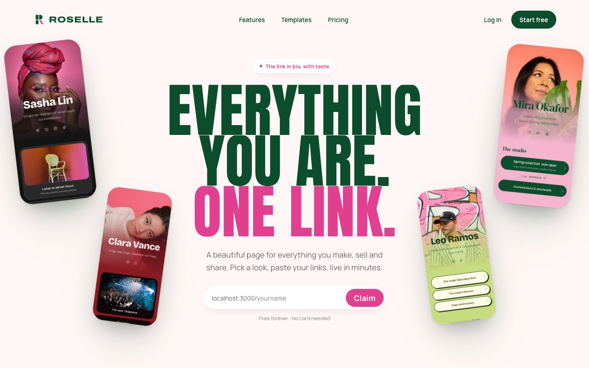
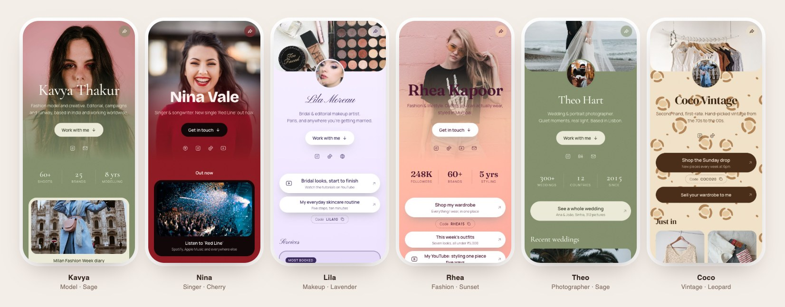
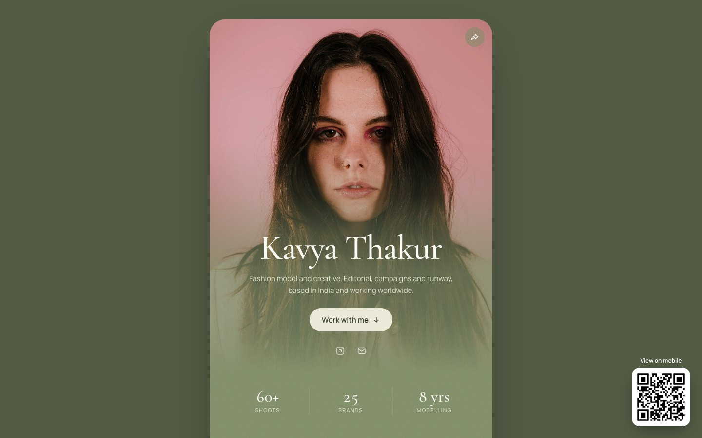
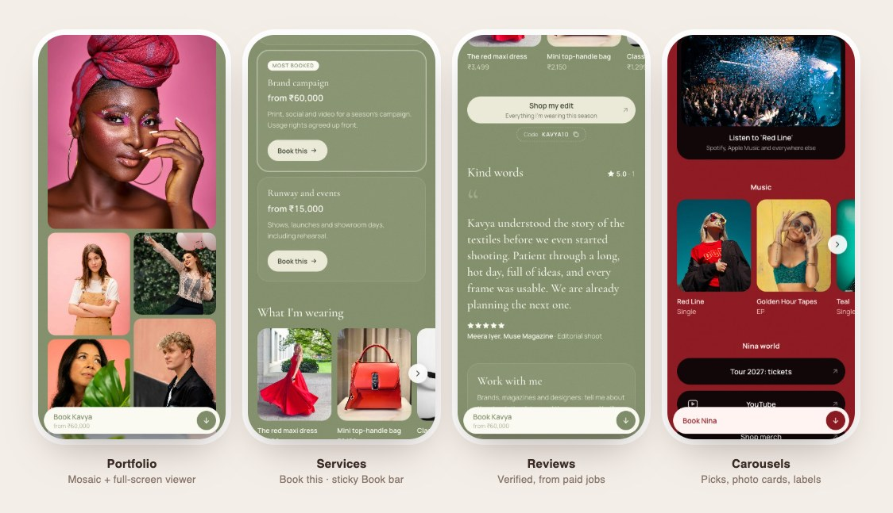
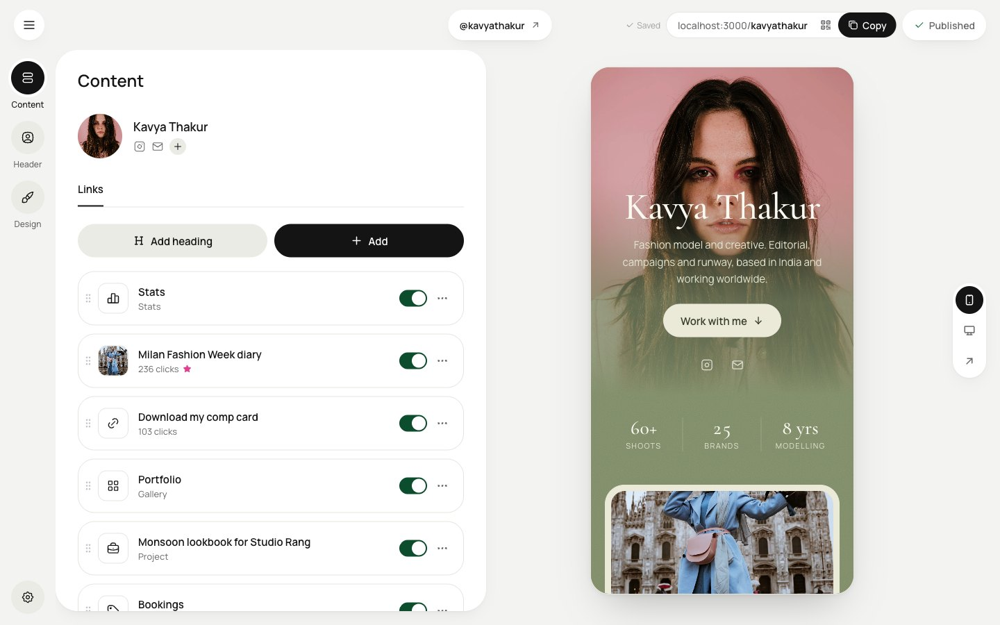
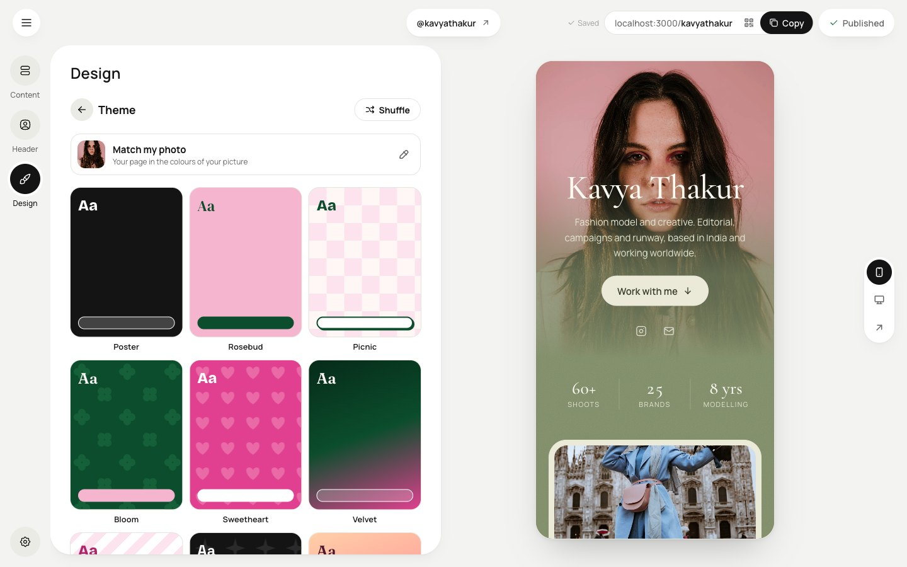
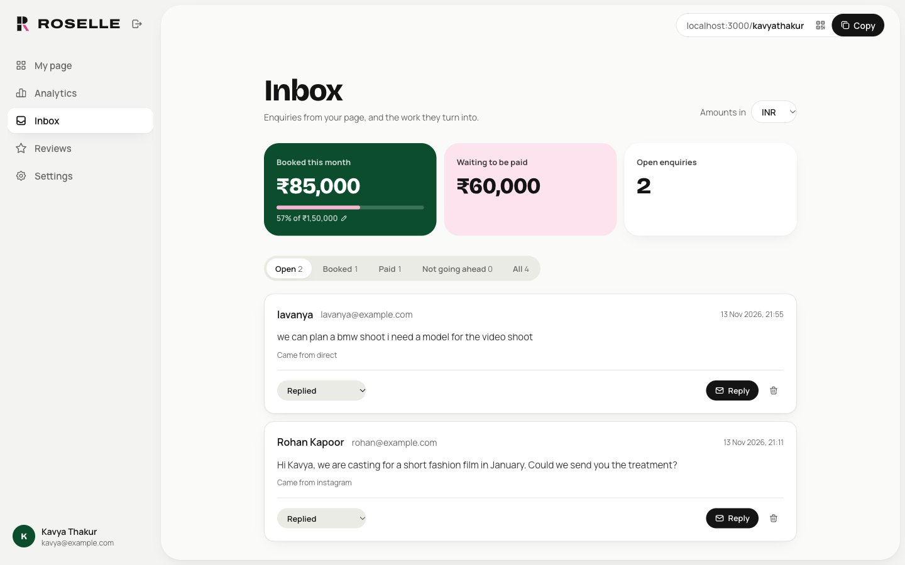
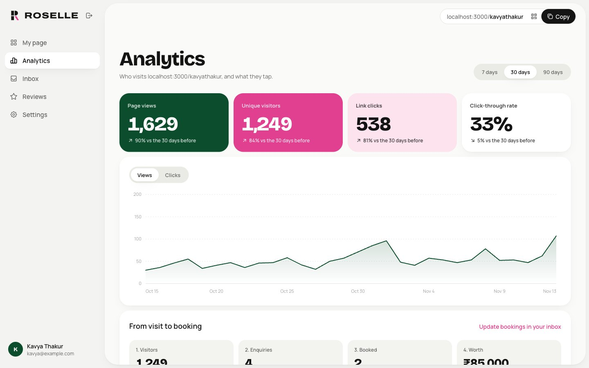
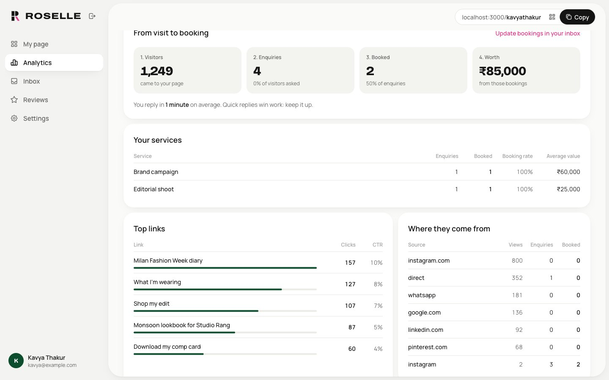
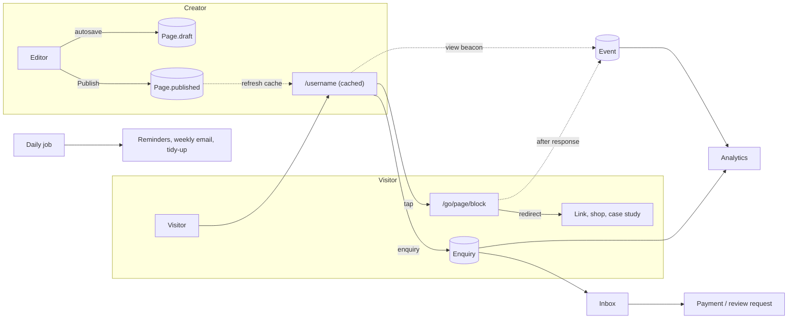

<div align="center">

# Roselle

**The link-in-bio that turns visitors into clients.**

A page for your work, your links and your story, and everything after the tap:
enquiries, bookings, payment requests, verified reviews and analytics that end in money, not clicks.




</div>

---

## Why Roselle

Link-in-bio tools stop at a list of links. For a photographer, a model, a makeup artist or a
designer, the link in their bio is the front door to their business, so the page should do
what a good studio assistant does: show the work beautifully, take the enquiry, follow up,
ask for payment, collect the review, and say which posts actually brought paid work.

Roselle does all of that, runs entirely on free plans (Vercel, Neon, Brevo), and never touches
the creator's money: payments go straight to their own PayPal, UPI or payment page.

## A page that looks like you

25 templates, from quiet editorial serifs to the bold one-colour looks that the best creator pages
use: a full-bleed photo melting into a single strong colour. Or press **Match my photo** and the
page takes its colours from the creator's own picture.



On a laptop the page becomes a centred card on a darkened backdrop of its own colours, with a QR
code to carry it over to a phone.



**15 block types**: links (with a second line, an icon or thumbnail, and a tap-to-copy discount
code), photo cards, headings, text, images, galleries (grid, mosaic or carousel), projects with
full case-study pages, Picks (products or favourites), Stats, services with prices, verified
reviews, a contact form, music players, maps, videos and tips.



## The editor

A live preview beside every change, drag to reorder, hide or schedule any block, undo and redo
(⌘Z / ⇧⌘Z), and autosave. Nothing goes live until **Publish**, and *Discard changes* puts the draft
back to the live page.

| Content | Design |
| --- | --- |
|  |  |

## From visit to paid work

Every enquiry lands in the **Inbox** (and in the creator's email, where Reply goes straight to the
client). Each one moves through *New → Replied → Booked → Paid*, with amounts, a monthly goal,
and one-tap messages written in the creator's own voice, sent from their own WhatsApp or email:

- **Payment requests** with their payment link or UPI ID
- **Review requests** with a one-time link that only that client can use; reviews show only once approved



**Analytics** answer the question that matters: which sources and which services bring paid work.
Views, unique visitors and clicks sit next to a funnel from visitors to enquiries to bookings to
money, plus per-link clicks, traffic sources and average reply time.

| Overview | Funnel, services, links and sources |
| --- | --- |
|  |  |

A daily job sends a morning reminder when an enquiry has waited a day, and a Monday summary of the week.

<sub>Example creators are made up; photographs are from Unsplash.</sub>

---

## Features

<table>
<tr><td valign="top" width="50%">

**Pages**
- 25 templates, 8 fonts, 9 patterns, gradients, glows and photo backgrounds
- Poster, banner or classic headers; section titles as headings or labels
- Match my photo: a colour scheme from the creator's picture
- Full-screen photo viewer, swipe or arrow keys
- Case-study page for any project
- Share button, share image (Open Graph) and QR code (PNG / SVG)
- Sticky *Book* bar that appears once the intro scrolls away
- SEO title and description per page

</td><td valign="top" width="50%">

**Business**
- Services with prices, *Most booked* badge and per-service enquiries
- Inbox pipeline with amounts, currency and a monthly goal
- Payment and review requests in the creator's own voice
- Verified reviews, approved before they show
- Analytics funnel from visit to money, by source and by service
- Morning reminders and a weekly email
- Tips and payments to the creator's own accounts, no fees

</td></tr>
<tr><td valign="top">

**Accounts and safety**
- Email confirmation, password reset, change password, delete account
- First-run onboarding that builds a starter page for the creator's trade
- Report a page; an admin area to take pages down and restore them
- Privacy policy and terms written from what the code does

</td><td valign="top">

**Quality**
- 121 tests, the API ones against a real Postgres database
- Responsive from a phone to a wide desktop
- Toasts, skeleton loaders, empty states and error pages throughout
- Public pages cached and served as files
- Privacy-friendly analytics: no cookies for visitors, no IP addresses stored

</td></tr>
</table>

## How it works



**A page is one JSON document.** Profile, SEO, theme and blocks live in a single document checked
by one Zod schema (`src/lib/validations/page.ts`) and drawn by one component
(`src/components/PageRenderer.tsx`). The editor autosaves to `draft`; Publish copies it to
`published`, the only version visitors ever see. Adding a block type is one schema entry and one
case in the renderer, and old pages stay valid because new fields have defaults.

**Public pages are static files.** `/<username>`, its case studies and its share image are built
on the first visit and cached (`generateStaticParams` + `revalidate`). Publishing, renaming,
approving a review or a take-down refreshes them at once.

**Links can't be abused.** Only `http(s)`, `mailto` and `tel` addresses (and the creator's own
uploads) reach an `href` (`safeHref`). Every tap goes through `/go/<page>/<block>`, which reads the destination from the
published page, never from the URL, so it can't be used as an open redirect.

**Analytics without tracking people.** A visitor is a hash of IP, browser, day and a secret
salt, never the IP itself, and it changes daily. Bots and link previews aren't counted. Clicks are
recorded after the redirect is sent (`after()`), so counting never slows anyone down.

**The client loop stays the creator's.** Payment and review requests are written in the creator's
voice and sent from their own WhatsApp or email (`src/lib/messages.ts`). Roselle can email for
them if they prefer, but the default is that a client hears from the person they booked.

### Engineering decisions worth knowing

| Decision | Why |
| --- | --- |
| Postgres JSON document for the page, relational tables for everything that's queried | The page is always read and written whole; enquiries, reviews and events are filtered and counted |
| Indexes shaped like the questions | `Event (pageId, type, createdAt)` serves every analytics count; unique visitors are `count(DISTINCT …)` in SQL |
| Photos shrunk in the browser before upload | A 20 MB phone photo arrives as a few hundred KB of WebP at 1800px; served with year-long browser and CDN caching |
| Functional state updates throughout the editor | An upload finishing late can never undo edits made while it ran |
| Emails sent after the response | A slow or failing email never loses an enquiry |
| Daily tidy-up | Expired sessions and links, and visits older than 400 days, so the free database never fills |
| No payment provider | Money goes straight to the creator; no fees, no PCI scope, no payouts to reconcile |
| Few dependencies | Drag and drop, the chart, the carousel and the photo viewer use the browser's own features |

## Tech stack

| | |
| --- | --- |
| **Framework** | Next.js 16 (App Router, Turbopack), React 19, TypeScript |
| **Data** | PostgreSQL, Prisma 7 with the `pg` driver adapter |
| **Validation** | Zod 4, one schema per action shared by form and route |
| **Styling** | Tailwind CSS 4 with container queries, `next/font` |
| **Forms** | React Hook Form |
| **Images** | `next/og` (Satori) for share images, `qrcode` for QR codes |
| **Motion** | GSAP on the landing page only |
| **Email** | Brevo HTTP API (one `fetch`) |
| **Tests** | Vitest: unit tests, and API tests against a real Postgres database |
| **Hosting** | Vercel Hobby + Neon + Brevo, all free |

## Getting started

Requirements: Node 20+, PostgreSQL 15+.

```bash
git clone https://github.com/kavya-thakur/roselle.git
cd roselle
createdb roselle
cp .env.example .env          # set DATABASE_URL, APP_URL, VISITOR_SALT
npm install                   # also generates the Prisma client
npx prisma migrate deploy
npm run dev                   # http://localhost:3000
```

Without `BREVO_API_KEY`, emails are printed in the terminal instead of sent, so everything works
locally with no accounts.

### Environment

| Variable | What it's for |
| --- | --- |
| `DATABASE_URL` | Postgres connection (Neon: the pooled one) |
| `DIRECT_URL` | Neon's direct connection, for migrations |
| `APP_URL` | The public address, for share images and links |
| `VISITOR_SALT` | Secret mixed into visitor hashes (`openssl rand -hex 32`) |
| `BREVO_API_KEY`, `MAIL_FROM` | Sending email; leave empty locally |
| `ADMIN_EMAILS` | Who can open `/admin` (comma separated) |
| `CONTACT_EMAIL` | Shown on the privacy and terms pages (defaults to `MAIL_FROM`) |
| `CRON_SECRET` | Protects the daily job (`openssl rand -hex 32`) |

### Scripts

| | |
| --- | --- |
| `npm run dev` | Development server |
| `npm run build` / `npm start` | Production build and server |
| `npm test` | Every test (creates its own `roselle_test` database) |
| `npm run test:unit` | Rules and calculations only, no database, under a second |
| `npm run test:api` | Route handlers against a real database, with email and caching mocked |
| `npm run lint` | ESLint |

## Testing

The API tests call the real route handlers against a real Postgres database, reset between tests,
with only the outside world (email, cache refresh) replaced. They cover signing up and in, saving
and publishing, the click redirect and its open-redirect protection, uploads, enquiries through to
payment and review requests, review links that work once, moderation, the daily job and the
analytics totals. The key ones were checked against deliberately planted bugs, to make sure they fail
when the code they guard breaks.

```bash
npm test
#  Test Files  7 passed (7)
#       Tests  121 passed (121)
```

## Deploying for $0

| What | Service | Free limit |
| --- | --- | --- |
| App | [Vercel](https://vercel.com) Hobby | Non-commercial use |
| Database | [Neon](https://neon.tech) | 0.5 GB, photos included |
| Email | [Brevo](https://brevo.com) | 300 emails a day |

1. **Neon**: create a project; copy the pooled and the direct connection strings.
2. **Brevo**: verify a sender address and create an API key.
3. **Vercel**: import the repository and set the variables above. `vercel-build` applies the
   migrations, then builds. `vercel.json` schedules the daily job.

Maps and music use keyless embeds, and payments go to the creator's own accounts, so there are no
other services, keys or fees.

## Project structure

```
prisma/
  schema.prisma            User, Session, Token, Page, Enquiry, Review, Report, Event, Media
  migrations/
src/
  app/
    (marketing)/           landing page
    (auth)/                sign up, sign in, forgot / reset password
    (dashboard)/           editor/, welcome/, and (shell)/: inbox, analytics, reviews, settings, admin
    (legal)/               privacy, terms, report a page, leave a review
    [username]/            public page, case studies, share image, view tracker
    go/[pageId]/[blockId]/ counts a tap, then redirects
    media/[id]/            uploaded images
    api/                   auth, page, publish, media, enquiry, reviews, settings, admin, cron
  components/              PageRenderer and its client islands (Carousel, Lightbox, HireBar…),
                           Toast, Skeleton, EmptyState
  lib/
    validations/           Zod schemas
    pages/                 templates, patterns, colour matching, blocks, link safety, publishing
    analytics/             recording events, the numbers for the analytics screen
    reports/               reminders, weekly email, tidy-up
    auth/  api/  db/  email/  messages.ts  bookings.ts  plans.ts
tests/
  unit/                    pure rules: schemas, links, colours, money, wording
  api/                     route handlers against Postgres
```

## Moderation

Every public page has a quiet *Report this page* link. Reports reach `/admin` (only the emails in
`ADMIN_EMAILS`) and their inboxes. An admin can take a page down (visitors get a 404, its links stop
redirecting, it can't be republished, and the owner is told why), restore it, or dismiss the report.

## Plans

Everything is free today. `src/lib/plans.ts` lists each feature that could become Pro (photo
backgrounds, patterns, scheduling, SEO, music, maps, tips, 90-day analytics), all set to
`pro: false`. Switch one on and free accounts can still try it in the editor, but Publish asks them
to remove it, and the pricing section on the landing page moves it to the Pro card.

## Known limits

Marked with `ponytail:` comments in the code, each with the point at which it should change.

- Photos are stored in Postgres: fine for a beta, move to object storage (Cloudflare R2) before a
  public launch.
- Sign-in rate limits are counted per server; use a shared store (Upstash Redis) on serverless.
- The inbox loads every enquiry for a page; paginate past a few thousand.
